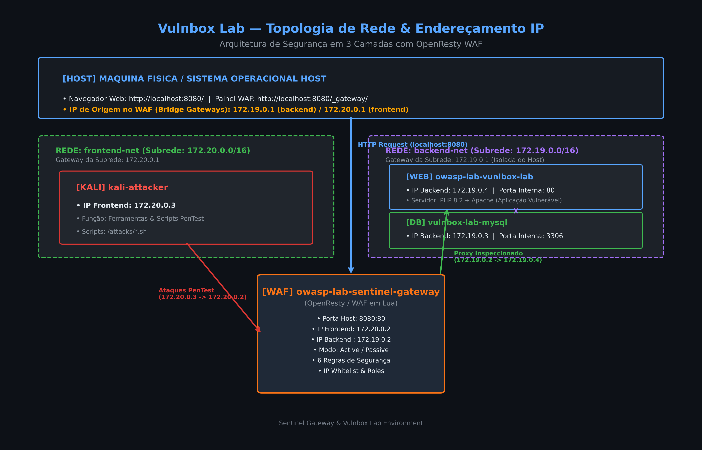

# 🛡️ Sentinel Gateway

## Visão Geral

O **Sentinel Gateway** é um proxy reverso com WAF (Web Application Firewall) baseado em **OpenResty (nginx + LuaJIT)**, posicionado entre a máquina atacante (Kali Linux) e a aplicação web.



```
[Host / Browser] ────▶ [owasp-lab-sentinel-gateway] ──── backend-net (172.19.0.0/16) ────▶ [owasp-lab-vunlbox-lab] (172.19.0.4)
  172.19.0.1 (Bridge)    172.19.0.2 / 172.20.0.2                                [vulnbox-lab-mysql] (172.19.0.3)
                            ▲
[kali-attacker]  ───────────┘ frontend-net (172.20.0.0/16)
  172.20.0.3
```

---

## Início Rápido

```bash
# Subir todo o ambiente
docker compose up -d --build

# Verificar status do WAF
curl -s http://localhost:8080/_gateway/status | python3 -m json.tool

# Acessar o lab no browser
open http://localhost:8080
```

---

## Endpoints de Controle do Gateway

Todos os endpoints respondem em JSON e estão em `http://localhost:8080/_gateway/`.

| Método | Endpoint | Descrição |
|--------|----------|-----------|
| `GET` | `/_gateway/` | Painel de controle Web em abas (Controle Global, Lista de IPs com TTL, Parâmetros e Regras WAF) |
| `GET` | `/_gateway/status` | Modo atual do WAF, status de cada regra, parâmetros e array `blocked_ips` com TTL em tempo real (JSON) |
| `POST` | `/_gateway/toggle` | Alterna modo Global active ↔ passive |
| `POST` | `/_gateway/activate` | Ativa o WAF globalmente |
| `POST` | `/_gateway/deactivate` | Desativa o WAF globalmente (proxy puro) |
| `POST` | `/_gateway/rule/toggle` | Alterna o estado de uma regra específica (`rule=BRUTE_FORCE_LOGIN`, `PATH_TRAVERSAL`, etc.) |
| `POST` | `/_gateway/rule/toggle_all` | Alterna o estado de todas as regras WAF de uma vez (botão único toggle) |
| `POST` | `/_gateway/rule/activate_all` | Ativa todas as regras WAF de uma vez |
| `POST` | `/_gateway/rule/deactivate_all` | Desativa todas as regras WAF de uma vez |
| `POST` | `/_gateway/block` | Bloqueia um IP manualmente na `IP_BLOCKLIST` (`ip=X.X.X.X` e `time=3600` em segundos) |
| `POST` | `/_gateway/unblock` | Desbloqueia um IP específico por falso positivo (`ip=X.X.X.X` via POST ou query arg) |
| `POST` | `/_gateway/reset` | Limpa todos os bloqueios e contadores |

### Exemplos

```bash
# Verificar modo, regras e lista de IPs bloqueados com tempo restante (TTL)
curl -s http://localhost:8080/_gateway/status

# Bloquear um IP manualmente por 3600 segundos (1 hora)
curl -s -X POST -d "ip=192.168.1.50&time=3600" http://localhost:8080/_gateway/block

# Desbloquear um IP específico (Falso Positivo)
curl -s -X POST -d "ip=172.20.0.3" http://localhost:8080/_gateway/unblock

# Ativar/Desativar uma regra específica (ex: BRUTE_FORCE_LOGIN ou PATH_TRAVERSAL)
curl -s -X POST -d "rule=BRUTE_FORCE_LOGIN" http://localhost:8080/_gateway/rule/toggle

# Ativar WAF
curl -s -X POST http://localhost:8080/_gateway/activate

# Desativar WAF (modo passivo — vulnerabilidades expostas)
curl -s -X POST http://localhost:8080/_gateway/deactivate

# Limpar todos os bloqueios
curl -s -X POST http://localhost:8080/_gateway/reset
```

---

## Regras WAF


### Regra 1 — IP Blocklist (IP_BLOCKLIST) — A01 / A07
Inspeciona cada requisição e bloqueia imediatamente IPs presentes na lista de bloqueio (`block_dict`).
- **Gatilhos Automáticos:** Violações de Força Bruta (`BRUTE_FORCE_LOGIN`), Enumeração Admin (`ADMIN_ENUMERATION`), IDOR (`IDOR_ENUMERATION`) e Path Traversal (`PATH_TRAVERSAL`).
- **Bloqueio Manual:** Permite inserção manual de IPs via Web UI (Aba "IPs Bloqueados") ou API HTTP (`POST /_gateway/block`).
- **Comportamento:** Retorna **HTTP 403 Forbidden** com mensagem detalhada informando o IP e a **Regra de Origem** do bloqueio. IPs cadastrados na Whitelist de Administrador ignoram esta restrição.

### Regra 2 — Força Bruta no Login (BRUTE_FORCE_LOGIN) — A07
Rastreia tentativas de `POST /login.php` por IP em janela deslizante de 3600 segundos (configurável via Web UI).
- **Limite:** 3 tentativas em 3600s (configurável via Web UI)
- **Ação:** HTTP 429 + IP bloqueado por 3600 segundos (1 hora)

### Regra 3 — Política de Senha Fraca (WEAK_PASSWORD_POLICY) — A07
Inspeciona o corpo de `POST /login.php` antes de enviar à aplicação:
- **Tamanho Mínimo:** Rejeita senhas com menos de 8 caracteres.
- **Lista de Senhas Conhecidas:** Rejeita senhas em dicionários vulneráveis (`123456`, `admin123`, `password`, `qwerty`, etc.).
- **Complexidade:** Exige pelo menos uma letra e um número.
- **Ação:** HTTP 400 Bad Request imediato.

### Regra 4 — Enumeração e Proteção de Rotas Admin (ADMIN_ENUMERATION) — A01
Controla e restringe o acesso às rotas `/admin/*` via validação dupla:
- **Session Role Check:** Usuários autenticados com sessão ativa de administrador (`role=admin`) têm acesso livre. Usuários comuns (`user1`, `role=user`) têm o acesso bloqueado imediatamente (HTTP 403).
- **IP Whitelist (`admin_ip_whitelist`):** IPs cadastrados na Whitelist (configurável via Web UI em `http://localhost:8080/_gateway/`, padrão: `127.0.0.1`) ignoram a restrição.
- **Limite por IP:** 3 requisições/minuto para IPs não autorizados/não autenticados como admin (configurável via Web UI).
- **Ação:** HTTP 403 + IP bloqueado por 3600 segundos (1 hora).

### Regra 5 — IDOR Enumeration (IDOR_ENUMERATION) — A01
Detecta acesso rápido a múltiplos valores distintos do parâmetro `?id=` em `/profile.php` ou `/document.php`.
- **Limite:** 3 IDs distintos por minuto (configurável via Web UI)
- **Ação:** HTTP 403 + IP bloqueado por 3600 segundos (1 hora)

### Regra 6 — Path Traversal e Acesso a Arquivos Sensíveis (PATH_TRAVERSAL) — A01
Previne acesso não autorizado a arquivos de código/sistema e tentativas de travessia de diretório:
- **Detecção de Traversal:** Sequências `../`, `..\`, `%2e%2e`, `..%2f`, `..%5c` em URLs/parâmetros.
- **Detecção de Arquivos Sensíveis:** Acesso direto a `/.env`, `/.git`, `/src/`, `/database/`, `/.htaccess`, `*.sql`, `*.bak`, `*.log`.
- **Ação:** HTTP 403 imediato

---

## Máquina Kali Attacker

### Acessar o terminal do Kali

```bash
docker exec -it kali-attacker bash
```

### Scripts de Ataque Disponíveis

Todos os scripts estão em `/attacks/` dentro do container.

| Script | Ataque | OWASP |
|--------|--------|-------|
| `brute_force.sh` | Força bruta contra /login.php | A07 |
| `idor_profile.sh` | Enumeração de perfis via ?id= | A01 |
| `idor_document.sh` | Enumeração de documentos via ?id= | A01 |
| `admin_escalation.sh` | Escalada vertical para /admin/ | A01 |
| `path_traversal.sh` | Path Traversal e acesso a arquivos sensíveis | A01 |
| `session_fixation.sh` | Verificação de Session Fixation | A07 |
| `scanner.sh` | Detecção de bloqueio de scanners | A05 |
| `run_all.sh` | **Executa todos os ataques** | A01+A03+A05+A07 |

### Executar ataques

```bash
# De fora do container (host)
docker exec kali-attacker bash /attacks/run_all.sh

# De dentro do container
docker exec -it kali-attacker bash
cd /attacks
./run_all.sh

# Ataque individual
./brute_force.sh user1 wordlist.txt    # Força bruta com wordlist
./path_traversal.sh                   # Teste de Path Traversal (A01)
./idor_profile.sh
TARGET=http://owasp-lab-sentinel-gateway ./scanner.sh
```

---

## Fluxo de Demonstração

### Demonstração 1 — WAF Ativo (padrão)

```bash
# 1. Verificar que WAF está ativo
curl -s http://localhost:8080/_gateway/status

# 2. Executar ataque de força bruta pelo Kali
docker exec kali-attacker bash /attacks/brute_force.sh

# Resultado esperado: HTTP 429 após 3 tentativas
```

### Demonstração 2 — Sem WAF (modo passivo)

```bash
# 1. Desativar o WAF
curl -s -X POST http://localhost:8080/_gateway/deactivate

# 2. Executar todos os ataques
docker exec -it kali-attacker bash /attacks/run_all.sh

# Resultado esperado: ataques passam; app vulnerável (APP_MODE=vulnerable)
```

### Demonstração 3 — Comparação APP_MODE

```bash
# Modo vulnerável + WAF ativo: WAF para os ataques na borda
# Modo corrigido + WAF passivo: a própria app nega os ataques
# Modo corrigido + WAF ativo: duas camadas de defesa (Defense in Depth)
```

---

## Logs

```bash
# Logs do gateway (inclui decisões WAF)
docker logs owasp-lab-sentinel-gateway -f

# Logs de acesso formatados
docker exec owasp-lab-sentinel-gateway tail -f /var/log/nginx/access.log

# Logs de erro / bloqueios WAF
docker exec owasp-lab-sentinel-gateway tail -f /var/log/nginx/error.log
```

O log de acesso inclui o campo `waf_mode=active|passive` em cada linha.

---

## Arquitetura de Redes

| Rede | Sub-rede | Containers |
|------|----------|-----------|
| `frontend-net` | `172.20.10.0/24` | `kali-attacker` (10), `owasp-lab-sentinel-gateway` (1) |
| `backend-net` | `172.20.20.0/24` | `owasp-lab-sentinel-gateway` (1), `web` (DHCP), `mysql` (DHCP) |

> **Isolamento:** `kali-attacker` está **somente** na `frontend-net`. Não pode alcançar `web` ou `mysql` diretamente — todo tráfego passa pelo gateway.

---

## Estrutura de Arquivos

```
vulnbox-lab/
├── gateway/
│   ├── Dockerfile          # OpenResty Alpine
│   ├── nginx.conf          # Proxy reverso com integração WAF
│   └── waf/
│       ├── rules.lua       # Regras WAF (6 regras focadas em A01 e A07)
│       └── gateway_api.lua # API HTTP de controle
├── kali/
│   ├── Dockerfile          # Kali Linux com ferramentas
│   └── attacks/
│       ├── run_all.sh      # Executa todos os ataques
│       ├── brute_force.sh
│       ├── idor_profile.sh
│       ├── idor_document.sh
│       ├── admin_escalation.sh
│       ├── path_traversal.sh
│       ├── session_fixation.sh
│       └── scanner.sh
└── docker-compose.yml      # Ambiente completo
```

