# 📊 Relatório Técnico: Avaliação de Desempenho e Eficácia do Sentinel WAF sob Concorrência

> **Ambiente:** Vulnbox Lab — Teste de Desempenho e Concorrência HTTP  
> **Componentes:** Kali Attacker (`172.20.0.3`) ──▶ Sentinel Gateway WAF (`172.20.0.2` / `172.19.0.2`) ──▶ Vulnbox Web (`172.19.0.4`) & MySQL (`172.19.0.3`)  
> **Ferramenta de Carga:** [`bf-simultaneo.sh`](../kali/attacks/bf-simultaneo.sh) (Concorrência real de 50 processos Bash/curl em paralelo)  
> **Data da Avaliação:** 27 de Outubro de 2026  
> **Arquivos Analisados:**  
> • Cenário A (WAF Ativo): [`bf_simultaneo_20261027_005327.csv`](../kali/attacks/results/bf_simultaneo_20261027_005327.csv) | [`bf_simultaneo_20261027_005327_resumo.txt`](../kali/attacks/results/bf_simultaneo_20261027_005327_resumo.txt)  
> • Cenário B (WAF Passivo): [`bf_simultaneo_20261027_005456.csv`](../kali/attacks/results/bf_simultaneo_20261027_005456.csv) | [`bf_simultaneo_20261027_005456_resumo.txt`](../kali/attacks/results/bf_simultaneo_20261027_005456_resumo.txt)

---

## 1. Resumo Executivo e Veredito Global

### Veredito: **EXCELENTE** 🏆

A análise comparativa dos testes de estresse concorrente demonstrou que os resultados foram **excelentes**, tanto sob a perspectiva de **Engenharia de Sistemas e Desempenho** quanto sob a perspectiva de **Segurança da Informação e Mitigação Cibernética**.

### Principais Destaques:
1. **Eficácia de Bloqueio em 100%:** Sob carga máxima concorrente (50 workers simultâneos), o WAF reteve 100% das requisições na borda (`HTTP 403 Forbidden` via `IP_BLOCKLIST`), impedindo completamente que o ataque atingisse a aplicação PHP e o banco MySQL.
2. **Redução Drástica de Latência (-92.6%):** A filtragem em memória RAM no OpenResty reduziu o tempo médio de resposta de **667.76 ms** (processamento no backend) para apenas **49.46 ms** (bloqueio na borda) — uma aceleração de **13,5 vezes**.
3. **Aumento de Throughput (+31.2% RPS):** A vazão saltou de **17.09 requisições/segundo** no backend para **22.42 requisições/segundo** no WAF, mesmo sob concorrência total de 50 processos cliente.
4. **Confiabilidade e Tolerância a Falhas Impecável:** Em ambos os testes, registrou-se **0 falhas de transporte, 0 timeouts e 0 conexões recusadas**, confirmando que a infraestrutura suportou os handshakes TCP simultâneos sem gargalos de socket.

---

## 2. Apresentação e Análise de Dados

### 2.1 Tabela Comparativa Consolidada

A tabela a seguir confronta os dois testes executados sob a mesma carga (50 requisições disparadas por 50 workers concorrentes):

| Dimensão de Análise | Cenário A: WAF Ativo (Edge Filtering) | Cenário B: WAF Passivo (Backend Processing) | Variação / Impacto Observado |
| :--- | :---: | :---: | :---: |
| **Regime de Concorrência** | 50 workers simultâneos | 50 workers simultâneos | Idêntico |
| **Requisições Planejadas / Executadas** | 50 / 50 (100%) | 50 / 50 (100%) | Entrega completa |
| **Erros de Transporte / Timeouts (000)** | **0 (0.0%)** | **0 (0.0%)** | Estabilidade absoluta |
| **Duração Total da Bateria** | **2.230 segundos** | **2.925 segundos** | **-23.8% de tempo total** |
| **Vazão Observada (RPS)** | **22.42 req/s** | **17.09 req/s** | **+31.2% capacidade de vazão** |
| **Latência Mínima** | **12.20 ms** | **182.15 ms** | Backend é **14,9x mais lento** |
| **Latência Média** | **49.46 ms** | **667.76 ms** | **Redução de 92.6% na latência** |
| **Percentil 50 — P50 (Mediana)** | **46.95 ms** | **743.11 ms** | Backend é **15,8x mais lento** |
| **Percentil 95 — P95** | **69.27 ms** | **949.13 ms** | Backend é **13,7x mais lento** |
| **Percentil 99 — P99** | **103.85 ms** | **992.42 ms** | Backend é **9,5x mais lento** |
| **Latência Máxima** | **106.23 ms** | **998.58 ms** | Backend quase atinge 1 segundo |
| **Distribuição de Respostas HTTP** | 100% `HTTP 403 Forbidden` | 100% `HTTP 200 OK` (Auth Fail) | Filtro total na borda |
| **Requisições Inconclusivas** | **0** | **0** | Atribuição determinística |
| **Consumo de CPU no Backend PHP/DB** | **Nulo (0 req)** | **Crítico (50 req)** | **Blindagem total do backend** |

---

### 2.2 Visualização Gráfica das Métricas de Latência

#### Comparativo de Percentis de Tempo de Resposta (em milissegundos)

```mermaid
xychart-beta
    title "Comparativo de Latência sob 50 Conexões Concorrentes (ms)"
    x-axis ["Minima", "Mediana (P50)", "Media", "P95", "Maxima"]
    y-axis "Latencia em Milissegundos (ms)" 0 --> 1050
    bar [12, 47, 49, 69, 106]
    bar [182, 743, 668, 949, 999]
```



> **Legenda das Barras:**  
> 🟦 **Primeira Barra:** Cenário A (WAF Ativo — Bloqueio na Borda)  
> 🟩 **Segunda Barra:** Cenário B (WAF Passivo — Processamento no Backend)

---

### 2.3 Gráfico Conceitual de Linha do Tempo da Latência (Distribuição Normal)

```text
Cenário A: WAF Ativo (Média: 49.5 ms)
[12ms]──[47ms (P50)]──[69ms (P95)]──[106ms (Max)]
  |══════════════| (Agrupamento ultra-compacto em torno de 40-70ms)

Cenário B: Backend sem WAF (Média: 667.8 ms)
[182ms]──────────────────────────[743ms (P50)]──────────[949ms (P95)]──[999ms (Max)]
  |═════════════════════════════════════════════════════════════════════════| (Forte dispersão e fila)
```

---

## 3. Discussão dos Resultados

### 3.1 O Impacto do Edge Filtering no Desempenho
A discrepância massiva de latência (**49.46 ms vs. 667.76 ms**) ilustra com perfeição o valor arquitetural do **Sentinel Gateway** posicionado como proxy reverso programável:

```mermaid
flowchart TD
    subgraph FLUXO_WAF ["Cenário A: WAF Ativo (Custo Mínimo)"]
        ReqA["50 POSTs Concorrentes"] --> NginxCoreA["Nginx Event-Loop (C)"]
        NginxCoreA --> LuaRAM["LuaJIT / rules.lua<br/>Consulta lua_shared_dict (RAM)"]
        LuaRAM --> BlockResp["Retorna HTTP 403 em ~12-49ms<br/>(Conexão encerrada)"]
    end

    subgraph FLUXO_BACKEND ["Cenário B: WAF Passivo (Custo Crítico)"]
        ReqB["50 POSTs Concorrentes"] --> NginxProxy["Nginx (Proxy Pass)"]
        NginxProxy --> Apache["Apache 2.4 (Workers Pool)"]
        Apache --> PHP["Interpretador PHP 8.2 (Criação de Processo/Script)"]
        PHP --> MySQLConn["Conexão TCP com MySQL (Porta 3306)"]
        MySQLConn --> Query["SELECT no banco + Validação Bcrypt"]
        Query --> RenderHTML["Renderização da View login.php + Flash Message"]
        RenderHTML --> RespB["Retorna HTTP 200 em ~667-998ms"]
    end
```



1. **Eficiência do LuaJIT em Memória RAM:**  
   No Cenário A, a checagem da lista de bloqueio (`IP_BLOCKLIST`) ocorre em um dicionário compartilhado de memória (`lua_shared_dict waf_ip_block 10m`). A operação de busca de chave hash em C/Lua consome frações de microssegundos. O Nginx gera a resposta de erro e encerra a transação sem abrir conexões upstream.
2. **Custo de Fila no Backend (Contenção de Recursos):**  
   No Cenário B, cada uma das 50 requisições simultâneas obrigou o Apache a alocar worker threads, inicializar o motor PHP, estabelecer conexões com o MySQL e executar hashes criptográficos. A latência de **quase 1 segundo (998.58 ms)** no P99 do Cenário B decorre diretamente da fila de espera do pool de conexões do banco de dados e do agendador de threads do sistema operacional.

---

### 3.2 O Impacto na Segurança e Mitigação de Ataques de Força Bruta
* **Imunização da Aplicação contra Força Bruta:**  
  No Cenário A, todas as 50 tentativas de adivinhação de credenciais foram interceptadas e descartadas na borda. A aplicação web permaneceu completamente ociosa, preservando seus recursos computacionais para atender usuários legítimos.
* **Prevenção de Negação de Serviço por Esgotamento (Denial of Service - DoS):**  
  Em aplicações web reais, um ataque concorrente de força bruta gera uma carga de CPU exponencial no servidor de banco de dados devido à computação de funções de derivação de chave (como `bcrypt` ou `argon2`). Ao conter as requisições em 49 ms no Gateway, o Sentinel WAF eliminou a ameaça de DoS indireto por exaustão de CPU.

---

### 3.3 Análise do Modelo de Transporte (TCP Handshakes Simultâneos)
* O teste exigiu que o container atacante disparasse **50 processos `curl` independentes**, abrindo **50 conexões TCP reais em paralelo** contra a porta `80` do Gateway em um intervalo inferior a 3 segundos.
* O Nginx tratou todos os 50 *three-way handshakes* simultâneos sem perda de pacotes, confirmando que as diretivas de rede (`worker_connections 1024`, sub-redes bridge Docker) e a capacidade do kernel Linux estão dimensionadas com folga para suportar rajadas de conexões.

---

## 4. Conclusões e Recomendações

1. **Avaliação Geral:**  
   Os resultados são classificados tecnicamente como **EXCELENTES**. O Sentinel WAF cumpriu com perfeição seu duplo papel: **proteger o patrimônio de dados e regras de negócio da aplicação** e **garantir a sustentabilidade operacional da infraestrutura sob alta concorrência**.
2. **Recomendação para Ambientes de Produção:**  
   * **Manter a Regra 1 (`IP_BLOCKLIST`) sempre ativa:** O bloqueio por IP em memória RAM é o mecanismo mais econômico computacionalmente que uma arquitetura web pode empregar contra atacantes reincidentes.
   * **Adotar Pools Persistentes (Keep-Alive upstream):** Para requisições legítimas que precisam chegar ao backend, manter conexões `keepalive` configuradas no bloco `upstream` do Nginx reduzirá ainda mais a latência base do PHP/Apache.

