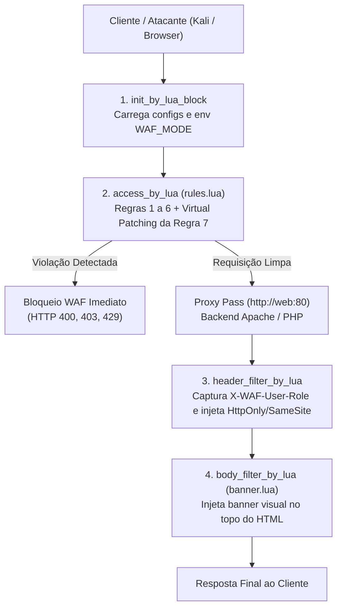

# 🛡️ Sentinel Security Gateway — WAF OpenResty
## Documentação Técnica e Funcional das Regras de Segurança

> **Projeto:** Vulnbox Lab — Laboratório Acadêmico de Segurança OWASP Top 10  
> **Tecnologia:** OpenResty (Nginx Core + LuaJIT)  
> **Versão:** 6.0  
> **Arquivo Original:** [`docs/regras_openresty.txt`](regras_openresty.txt)

---

## 1. Visão Geral da Arquitetura do WAF

O **Sentinel Security Gateway** é um proxy reverso programável construído sobre o **OpenResty (Nginx com LuaJIT)**. Ele atua na borda da aplicação (*Edge Security*), posicionado entre clientes/atacantes (rede externa / Kali) e os contêineres internos da aplicação web (Apache/PHP) e banco de dados (MySQL).

O WAF intercepta cada requisição HTTP e aplica lógica de inspeção em diferentes fases do ciclo de vida do Nginx, sem depender de modificações no código-fonte legado da aplicação — técnica conhecida como **Virtual Patching**.

### 1.1 Ciclo de Vida das Requisições no OpenResty



---

### 1.2 Memória Compartilhada (`lua_shared_dict`)

O OpenResty aloca segmentos de memória RAM compartilhados entre todos os worker processes do Nginx:

| Dicionário | Tamanho | Finalidade |
| :--- | :--- | :--- |
| `waf_mode` | **1 MB** | Armazena o modo global (`active` ou `passive`) e o status individual de ativação de cada regra. |
| `waf_config` | **1 MB** | Parâmetros dinâmicos e limiares das regras (limites de tentativas, janelas de tempo, listas de IPs). |
| `waf_rate` | **10 MB** | Contadores de janelas deslizantes (*Rate Limiting*) indexados por IP e sessão. |
| `waf_ip_block` | **10 MB** | Tabela de IPs temporariamente bloqueados com seus respectivos tempos de expiração (TTL). |

---

## 2. Detalhamento das Regras do WAF (Regras 1 a 7)

---

### Regra 1: `IP_BLOCKLIST` (Lista Negra Dinâmica de IPs)

* **Identificador no Código:** `IP_BLOCKLIST`
* **Fase de Execução:** `access_by_lua` ([`gateway/waf/rules.lua`](file:///home/kali/antigravity/vulnbox-lab-v6-openresty/gateway/waf/rules.lua))
* **Categoria OWASP:** Transversal (A01: Broken Access Control / A07: Auth Failures)
* **Status Padrão:** Ativa (quando o WAF está em modo `active`)

#### Como Funciona
É a primeira regra executada no pipeline. Antes de inspecionar parâmetros, payloads ou rotas da requisição, o WAF consulta a tabela em memória `block_dict` (`waf_ip_block`) buscando o IP do cliente (`ngx.var.remote_addr`).

#### Mecânica Interna
1. Verifica se a regra está ativa (`is_rule_active("IP_BLOCKLIST")`).
2. Verifica se o IP do cliente consta na **Whitelist de Administrador** (`admin_ip_whitelist`). Se for um IP liberado, o bloqueio é ignorado.
3. Se o IP constar em `block_dict` e não for whitelisted:
   * O WAF aborta a requisição imediatamente.
   * Recupera a regra de origem que causou a punição inicial (armazenada como valor da chave no dicionário).

#### Ação em Caso de Violação
* **Código HTTP:** `403 Forbidden`
* **Header WAF:** `X-WAF-Rule: IP_BLOCKLIST`
* **Resposta:** Página HTML personalizada informando o IP bloqueado e a regra de origem.

> [!NOTE]
> **Como um IP entra na Blocklist:**
> Um IP é inserido automaticamente quando viola os limites das Regras 2 (Brute Force), 4 (Admin Enumeration), 5 (IDOR) ou 6 (Path Traversal), ou manualmente via endpoint da API (`POST /_gateway/block`).

---

### Regra 2: `BRUTE_FORCE_LOGIN` (Proteção contra Força Bruta no Login)

* **Identificador no Código:** `BRUTE_FORCE_LOGIN`
* **Fase de Execução:** `access_by_lua` ([`gateway/waf/rules.lua`](file:///home/kali/antigravity/vulnbox-lab-v6-openresty/gateway/waf/rules.lua))
* **Categoria OWASP:** A07:2021 — Identification and Authentication Failures
* **Alvo Monitorado:** `POST /login.php`

#### Como Funciona
Monitora e restringe a taxa de tentativas de autenticação enviadas para o endpoint de login por um mesmo endereço IP dentro de uma janela deslizante de tempo.

#### Mecânica Interna
1. O WAF intercepta requisições `POST` para `/login.php`.
2. Lê o corpo da requisição e mapeia a tentativa para a chave `bf:<IP>` no dicionário `waf_rate`.
3. Executa a operação atômica `rate_dict:incr(key, 1, 0, bf_window)`.
4. **Parâmetros Dinâmicos (ajustáveis via API/Web UI):**
   * `bf_limit`: Limite máximo de tentativas permitidas (Padrão: **3**).
   * `bf_window`: Janela de tempo de observação (Padrão: **3 segundos**).
   * `bf_block_time`: Duração do banimento temporário (Padrão: **3600 segundos / 1 hora**).
5. Se o contador ultrapassar `bf_limit` dentro da janela:
   * O IP é gravado em `block_dict` com TTL de `bf_block_time`.
   * Adiciona o cabeçalho HTTP `Retry-After: 3600`.

#### Ação em Caso de Violação
* **Código HTTP:** `429 Too Many Requests`
* **Header WAF:** `X-WAF-Rule: BRUTE_FORCE_LOGIN`
* **Resposta:** Bloqueio imediato indicando o excesso de tentativas e tempo de espera.

> [!TIP]
> **Mapeamento Prévio de Sessão Administrativa:**
> Nesta mesma regra, o WAF inspeciona o campo `username`. Se o usuário autenticado for `admin`, o WAF já pré-associa na memória `waf_rate` a role `admin` ao cookie `PHPSESSID` (`role:<sess_id>`), alimentando a validação da Regra 4.

---

#### 🔍 Análise Aprofundada: Portabilidade e Customização da Regra 2

##### Q1: A Regra 2 funciona para qualquer aplicação pronta de fábrica ou precisa ser customizada?
**Ela precisa ser customizada!**  
Embora o conceito de *Rate Limiting* seja universal, a implementação da Regra 2 possui pontos de forte acoplamento com a arquitetura do Vulnbox Lab:
1. **A rota monitorada** está fixada como `/login.php`.
2. **O campo de usuário** inspecionado está fixado como `username`.
3. **O identificador de sessão** esperado está fixado como o cookie `PHPSESSID` (típico de PHP).

##### Q2: A verificação do campo de formulário é necessária para o bloqueio por Força Bruta?
**Depende da estratégia de defesa (Rate Limiting por IP vs. por Usuário):**

* **Para o Rate Limiting baseado em IP (como está implementado hoje):**
  O contador `bf:<IP>` conta qualquer requisição `POST` para `/login.php`, **mesmo que o invasor envie campos com nomes diferentes ou formulário vazio**. O bloqueio do IP ocorre independentemente do nome do campo de login.
* **Para o Mapeamento de Privilégios (Integração com a Regra 4):**
  O WAF precisa **obrigatoriamente** extrair `post_args.username` para saber se a tentativa é do `admin` e correlacionar ao cookie de sessão. Sem esse campo, o WAF não consegue conceder privilégios na borda.
* **Para a Proteção contra Password Spraying / Ataques Distribuídos:**
  Se um atacante usar uma botnet ou rede Tor (onde cada requisição vem de um IP diferente) para tentar senhas na mesma conta (ex: `admin`), o rate limit por IP é inútil. Para mitigar esse ataque, o WAF precisaria contar tentativas por usuário (`bf_user:<username>`), tornando a identificação do campo de formulário **100% mandatória**.

##### Q3: E se outra aplicação usar `email`, `user`, `login` ou `cpf` em vez de `username`?
**O mapeamento de usuário falha!**  
O código tenta ler exclusivamente:
```lua
local post_args = ngx.req.get_post_args()
if post_args and post_args.username then
```
Se a outra aplicação usar `name="email"` (padrão de praticamente toda plataforma web moderna), `post_args.username` retornará `nil`. Como consequência:
* O WAF não saberá qual usuário está tentando login.
* O mapeamento `role:<sess_id>` não será criado.
* Quando o usuário legítimo tentar acessar `/admin/`, a Regra 4 pode barrá-lo temporariamente até que o backend PHP retorne o cabeçalho `X-WAF-User-Role`.

##### Q4: E se o endpoint de login for diferente (ex: `/api/auth`, `/signin`, `/wp-login.php`)?
**A regra é completamente ignorada!**  
A condição inicial é:
```lua
if uri == "/login.php" and method == "POST" then
```
Se a aplicação externa usar qualquer outro caminho (como `/auth/login`, `/entrar`, `/api/v1/auth`), o bloco inteiro da Regra 2 **não é executado**. Não haverá contagem de tentativas nem bloqueio HTTP 429.

##### Q5: E se a aplicação for uma API REST ou Single Page App (React/Vue) enviando JSON?
Assim como na Regra 3, o método `ngx.req.get_post_args()` foi feito apenas para formulários HTML (`application/x-www-form-urlencoded`). Se a requisição enviar `Content-Type: application/json`:
* `ngx.req.get_post_args()` retornará vazio.
* O contador de IP ainda funcionará (caso a URI seja igual), mas o campo de usuário não será extraído a menos que o corpo seja decodificado com `cjson.decode(ngx.req.get_body_data())`.

##### Q6: E se o cookie de sessão não for `PHPSESSID`?
O código busca estritamente `ngx.var.cookie_PHPSESSID`. Se a outra aplicação for construída em outra linguagem ou framework:
* **Python (Django):** usa `sessionid`
* **Node.js (Express):** usa `connect.sid`
* **Java (Spring / Tomcat):** usa `JSESSIONID`
* **ASP.NET:** usa `ASP.NET_SessionId`
* **APIs Modernas:** usam cabeçalho `Authorization: Bearer <JWT>`

Em todos esses cenários, a amarração de privilégios falhará se não for adaptada para ler o cabeçalho ou cookie correspondente.

##### Q7: Como refatorar a Regra 2 para torná-la universal e resiliente?
Para que a Regra 2 funcione em qualquer aplicação web ou API, o script Lua deve ser configurado para:
1. **Suportar rotas flexíveis de login:**
   ```lua
   local login_routes = { ["/login"]=true, ["/login.php"]=true, ["/api/auth"]=true, ["/signin"]=true }
   if login_routes[uri] and method == "POST" then
   ```
2. **Varrer múltiplos sinônimos de campos de usuário:**
   ```lua
   local user_fields = {"username", "email", "login", "user", "usuario", "cpf"}
   local username = nil
   for _, field in ipairs(user_fields) do
       if post_args and post_args[field] then username = post_args[field]; break end
   end
   ```
3. **Aplicar Rate Limiting duplo (por IP e por Conta de Usuário):**
   * Chave 1: `bf_ip:` .. ip (protege contra força bruta clássica de um único invasor).
   * Chave 2: `bf_user:` .. tostring(username) (protege a conta contra ataques de dicionário distribuídos).
4. **Detectar o cookie ou token de sessão do framework utilizado.**

---

### Regra 3: `WEAK_PASSWORD_POLICY` (Política de Senhas Fracas e Complexidade)

* **Identificador no Código:** `WEAK_PASSWORD_POLICY`
* **Fase de Execução:** `access_by_lua` ([`gateway/waf/rules.lua`](file:///home/kali/antigravity/vulnbox-lab-v6-openresty/gateway/waf/rules.lua))
* **Categoria OWASP:** A07:2021 — Identification and Authentication Failures
* **Alvos Monitorados:**
  * `POST /login.php` (campo: `password`)
  * `POST /change-password.php` (campo: `new_password`)

#### Como Funciona
Inspeciona a senha enviada no corpo da requisição HTTP POST antes de repassá-la para o Apache/PHP ou banco de dados, aplicando critérios de higienização na borda.

#### Mecânica Interna (3 Testes Sequenciais em Lua)
1. **Validação de Tamanho Mínimo:**
   * Compara o comprimento `#pass` com `min_password_len` (Padrão: **8 caracteres**).
   * Rejeita se `#pass < min_length`.
2. **Dicionário de Senhas Conhecidas / Fracas:**
   * Converte a senha para minúsculas (`:lower()`) para busca *case-insensitive*.
   * Compara com a lista em memória: `123456`, `12345678`, `123456789`, `12345`, `password`, `qwerty`, `admin123`, `manager123`, `1234567`, `letmein`, `welcome`, `admin`, `user123`, `mudar123`, `senha123`, `a12345678`, etc.
3. **Validação de Complexidade:**
   * `pass:find("%a")`: Exige pelo menos uma letra (a-z, A-Z).
   * `pass:find("%d")`: Exige pelo menos um número (0-9).
   * Rejeita senhas puramente numéricas ou puramente alfabéticas.

#### Ação em Caso de Violação
* **Código HTTP:** `400 Bad Request`
* **Header WAF:** `X-WAF-Rule: WEAK_PASSWORD_POLICY`
* **Resposta:** Mensagem detalhada descrevendo a causa da rejeição (ex: *"Senha rejeitada: possui 6 caracteres (mínimo exigido: 8)"*).

---

#### 🔍 Análise Aprofundada: Portabilidade e Customização da Regra 3

##### Q1: A Regra 3 funciona para qualquer aplicação pronta de fábrica?
**Não.** É uma regra de Camada 7 específica (*Application-Aware Rule*). Ela depende do conhecimento prévio das rotas e do formato do formulário do Vulnbox Lab. Para outra aplicação, precisa ser adaptada ao contrato dessa nova aplicação.

##### Q2: Quais campos de formulário ela verifica exatamente?
Ela verifica estritamente duas chaves literais extraídas de `post_args`:
```lua
local pass = post_args and (post_args.password or post_args.new_password)
```
* Em `/login.php`: campo `password`.
* Em `/change-password.php`: campo `new_password`.

##### Q3: Se outra aplicação usar o mesmo nome de campo (`password`), ela consegue checar?
**Sim, mas apenas se:**
1. A rota for exatamente `/login.php` ou `/change-password.php`; e
2. O método for `POST`; e
3. Os dados vierem em formulário HTML (`application/x-www-form-urlencoded` ou `multipart/form-data`).

Se a outra aplicação usar o campo `password`, mas a rota for `/auth/login`, o teste não será acionado.

##### Q4: Se outra aplicação usar nomes de campos diferentes (`senha`, `pass`, `pwd`), ela verifica?
**Não verifica!**  
O comando `post_args.password` retornará `nil` (nulo em Lua). Como a variável `pass` será nula, o bloco de validação é **ignorado silenciosamente** e a requisição segue normalmente para o backend sem qualquer inspeção de senha fraca.

##### Q5: E se a aplicação enviar dados em JSON (APIs REST / React / Angular)?
O WAF **não conseguirá ler a senha** no estado atual do código.  
O método `ngx.req.get_post_args()` só lê formulários HTML clássicos. Para dar suporte a JSON, o script Lua precisa:
```lua
local body = ngx.req.get_body_data()
if body then
    local cjson = require "cjson"
    local json_data = cjson.decode(body)
    local pass = json_data and json_data.password
    if pass then check_weak_password(pass) end
end
```

##### Q6: Como tornar a Regra 3 genérica e universal?
1. **Lista flexível de rotas:** Correspondência por padrão (`uri:find("login")`, `uri:find("register")`, `uri:find("password")`).
2. **Varrer sinônimos de campos:**
   ```lua
   local candidate_fields = {"password", "senha", "pass", "passwd", "pwd", "new_password", "new_pass", "secret"}
   for _, field in ipairs(candidate_fields) do
       if post_args[field] then pass = post_args[field]; break end
   end
   ```
3. **Detectar o `Content-Type`** para chavear entre parser de formulário ou parser de JSON.

##### Q7: Boas práticas de produção e exigência de HTTPS (TLS):
* **Login vs. Cadastro:** Em produção, validar complexidade no endpoint de login impede usuários antigos de efetuarem login para trocar senhas legadas. Recomenda-se aplicar a rejeição estrita no **Cadastro/Alteração** e aplicar **Rate Limiting** (Regra 2) no Login.
* **Terminação TLS Obrigatória:** Para inspecionar senhas no corpo da requisição, o WAF precisa fazer a **descriptografia HTTPS na borda** (*SSL Offloading / TLS Termination*). Sem isso, o tráfego permanece criptografado e invisível ao WAF.

---

### Regra 4: `ADMIN_ENUMERATION` (Proteção de Rotas Admin e Escalada Vertical)

* **Identificador no Código:** `ADMIN_ENUMERATION`
* **Fase de Execução:** `access_by_lua` ([`gateway/waf/rules.lua`](file:///home/kali/antigravity/vulnbox-lab-v6-openresty/gateway/waf/rules.lua))
* **Categoria OWASP:** A01:2021 — Broken Access Control
* **Alvo Monitorado:** Qualquer rota iniciando com `/admin` (ex: `/admin/users.php`, `/admin/settings.php`)

#### Como Funciona
Impede que usuários anônimos ou usuários sem privilégios administrativos (ex: `user1`, role `user`) acessem ou enumerem painéis administrativos.

#### Mecânica Interna
1. Identifica requisições onde `uri:sub(1, 6) == "/admin"`.
2. Executa dupla validação de privilégios:
   * **IP Whitelist:** Verifica se o IP requisitante consta em `admin_ip_whitelist` (Padrão: `127.0.0.1`).
   * **Validação de Role de Sessão:** Lê o cookie `PHPSESSID` e consulta se a role gravada em `waf_rate` é `admin`.
3. Se o IP **não** for whitelisted e a sessão **não** for de `admin`:
   * Bloqueia o acesso imediatamente.
   * Incrementa o contador de tentativas não autorizadas (`admin:<IP>`).
   * Se ultrapassar `admin_limit` (Padrão: **3 requisições/minuto**): o IP é banido para a `IP_BLOCKLIST` por `admin_block_time` (Padrão: **3600 segundos**).

#### Ação em Caso de Violação
* **Tentativa Inicial:** `HTTP 403 Forbidden` (`X-WAF-Rule: ADMIN_ACCESS_DENIED`)
* **Enumeração Persistente (> 3 tentativas):** `HTTP 403 Forbidden` (`X-WAF-Rule: ADMIN_ENUMERATION`) + banimento do IP por 1 hora.

---

### Regra 5: `IDOR_ENUMERATION` (Detecção e Mitigação de Enumeração IDOR)

* **Identificador no Código:** `IDOR_ENUMERATION`
* **Fase de Execução:** `access_by_lua` ([`gateway/waf/rules.lua`](file:///home/kali/antigravity/vulnbox-lab-v6-openresty/gateway/waf/rules.lua))
* **Categoria OWASP:** A01:2021 — Broken Access Control
* **Alvos Monitorados:** `/profile.php?id=X` e `/document.php?id=X`

#### Como Funciona
Detecta ataques de **Referência Direta Insegura a Objetos (IDOR)**, nos quais um invasor faz requisições repetidas alterando sequencialmente o parâmetro `?id=` para coletar perfis e documentos de terceiros.

#### Mecânica Interna
1. Aplica-se a `/profile.php` ou `/document.php` quando há parâmetro `id`.
2. Caso a requisição não venha de administrador nem de IP whitelisted:
   * Rastreia o total de requisições: chave `idor_rate:<IP>:<URI>`.
   * Rastreia os **IDs distintos** consultados: chave `idor_ids:<IP>:<URI>`. Os valores são armazenados com marcadores (ex: `|1||2||3||4|`).
3. O WAF calcula a quantidade de IDs distintos acessados pelo mesmo IP nos últimos 60 segundos.
4. **Limiares de Bloqueio:**
   * `idor_distinct_limit`: Limite de IDs diferentes por minuto (Padrão: **3 IDs**).
   * `idor_limit`: Limite de requisições totais ao endpoint (Padrão: **15 requisições**).
   * `idor_block_time`: Duração do bloqueio (Padrão: **3600 segundos**).
5. Ao ultrapassar o limite, o IP é inserido na `IP_BLOCKLIST`.

#### Ação em Caso de Violação
* **Código HTTP:** `403 Forbidden`
* **Header WAF:** `X-WAF-Rule: IDOR_ENUMERATION`
* **Resposta:** Bloqueio com detalhamento da quantidade de IDs distintos observados.

---

### Regra 6: `PATH_TRAVERSAL` (Travessia de Diretório e Acesso a Arquivos Sensíveis)

* **Identificador no Código:** `PATH_TRAVERSAL`
* **Fase de Execução:** `access_by_lua` ([`gateway/waf/rules.lua`](file:///home/kali/antigravity/vulnbox-lab-v6-openresty/gateway/waf/rules.lua))
* **Categoria OWASP:** A01:2021 — Broken Access Control
* **Alvo Monitorado:** Todas as URIs e Query Strings recebidas

#### Como Funciona
Analisa o caminho completo da requisição e seus argumentos procurando padrões clássicos de travessia de pastas e tentativas de download de arquivos confidenciais do sistema e da aplicação.

#### Mecânica Interna (2 Tipos de Inspeção)
1. **Padrões de Traversal (inclusive com URL Encoding):**
   * `../` (diretório pai padrão Unix/Linux)
   * `..\` (diretório pai padrão Windows)
   * `%2e%2e` (codificação URL para `..`)
   * `..%2f` e `..%5c` (combinações de ponto com barras codificadas)
2. **Padrões de Arquivos e Diretórios Sensíveis:**
   * `^/%.env`: Arquivos com variáveis de ambiente e credenciais de banco.
   * `^/%.git`: Metadados e histórico do repositório Git.
   * `^/src/`: Código PHP interno localizado fora da raiz pública.
   * `^/database/`: Scripts SQL de inicialização do banco.
   * `^/%.htaccess`: Arquivos de configuração do Apache.
   * `%.sql$`, `%.bak$`, `%.log$`: Dumps de banco, cópias de segurança e logs.

#### Ação em Caso de Violação
* **Código HTTP:** `403 Forbidden`
* **Header WAF:** `X-WAF-Rule: PATH_TRAVERSAL`
* **Efeito:** Adiciona sumariamente o IP invasor à `IP_BLOCKLIST` por 3600 segundos.

---

### Regra 7: `SESSION_FIXATION_PROTECTION` (Virtual Patching contra Fixação de Sessão)

* **Identificador no Código:** `SESSION_FIXATION_PROTECTION`
* **Fases de Execução:**
  1. `access_by_lua` ([`gateway/waf/rules.lua`](file:///home/kali/antigravity/vulnbox-lab-v6-openresty/gateway/waf/rules.lua)) — Fase de Entrada / Requisição
  2. `header_filter_by_lua_block` ([`gateway/nginx.conf`](file:///home/kali/antigravity/vulnbox-lab-v6-openresty/gateway/nginx.conf)) — Fase de Saída / Resposta
* **Categoria OWASP:** A07:2021 — Identification and Authentication Failures
* **Alvo Monitorado:** `POST /login.php` (Entrada) e cabeçalhos `Set-Cookie` (Saída)

#### Como Funciona
Implementa **Virtual Patching** para neutralizar ataques de Fixação de Sessão (*Session Fixation*), protegendo a aplicação mesmo que o backend PHP esteja configurado em modo vulnerável (sem chamar `session_regenerate_id()`).

#### Mecânica Interna (Operação em 2 Frentes)

```mermaid
sequenceDiagram
    autonumber
    actor Attacker as Atacante / Vítima
    participant WAF as Sentinel Gateway (OpenResty)
    participant PHP as Aplicação Web (Apache/PHP)

    Note over Attacker,WAF: POST /login.php com Cookie PHPSESSID pré-fixado
    Attacker->>WAF: POST /login.php (Cookie: PHPSESSID=id_fixado)
    Note over WAF: rules.lua (Virtual Patching):<br/>Remove o PHPSESSID do cabeçalho Cookie
    WAF->>PHP: POST /login.php (Sem Cookie de Sessão)
    Note over PHP: PHP não vê sessão anterior,<br/>inicializa sessão nova e segura
    PHP-->>WAF: HTTP 302 (Set-Cookie: PHPSESSID=novo_id)
    Note over WAF: header_filter_by_lua:<br/>Injeta HttpOnly; SameSite=Strict
    WAF-->>Attacker: HTTP 302 (Set-Cookie: PHPSESSID=novo_id; HttpOnly; SameSite=Strict)
```

1. **Fase de Entrada (Virtual Patching em `rules.lua`):**
   * Ao detectar um `POST /login.php`, o WAF inspeciona o cabeçalho `Cookie`.
   * Se contiver `PHPSESSID`, remove-o via regex antes de repassar a requisição ao Apache:
     ```lua
     local new_cookie = cookie_hdr:gsub("PHPSESSID=[^;%s]+;?", "")
     ngx.req.set_header("Cookie", new_cookie ~= "" and new_cookie or nil)
     ```
   * O PHP recebe a requisição limpa e é forçado a gerar um novo Session ID aleatório.
2. **Fase de Saída (Endurecimento de Cookies em `nginx.conf`):**
   * Quando o backend responde com `Set-Cookie: PHPSESSID=...`, o OpenResty garante a adição das diretivas de proteção:
     * `; HttpOnly`: Impede leitura do cookie via scripts JavaScript (mitiga roubo por XSS).
     * `; SameSite=Strict`: Impede o envio do cookie em requisições de sites externos (mitiga CSRF).

---

## 3. Matriz Resumo das Regras

| # | Regra | OWASP | Fase Nginx | Código de Retorno | Ação de Mitigação |
| :-: | :--- | :-: | :--- | :-: | :--- |
| **01** | `IP_BLOCKLIST` | Geral | `access_by_lua` | `HTTP 403` | Bloqueia IPs reincidentes ou cadastrados manualmente. |
| **02** | `BRUTE_FORCE_LOGIN` | **A07** | `access_by_lua` | `HTTP 429` | Limita taxa de requisições de login e bloqueia IP por 1 hora. |
| **03** | `WEAK_PASSWORD_POLICY` | **A07** | `access_by_lua` | `HTTP 400` | Rejeita senhas curtas, de dicionário ou sem complexidade. |
| **04** | `ADMIN_ENUMERATION` | **A01** | `access_by_lua` | `HTTP 403` | Valida IP Whitelist e papel de sessão em rotas `/admin/*`. |
| **05** | `IDOR_ENUMERATION` | **A01** | `access_by_lua` | `HTTP 403` | Rastreia e bloqueia enumeração de múltiplos IDs por IP. |
| **06** | `PATH_TRAVERSAL` | **A01** | `access_by_lua` | `HTTP 403` | Bloqueia `../` e acesso a arquivos confidenciais (`.env`, `.git`). |
| **07** | `SESSION_FIXATION_PROTECTION` | **A07** | `access` + `header` | *Virtual Patch* | Remove cookie pré-login e injeta `HttpOnly`/`SameSite`. |

---

## 4. Gestão e Controle Dinâmico do WAF via API

O Sentinel Gateway expõe uma interface gráfica e uma API REST na rota `/_gateway/` para controle em tempo real sem necessidade de reiniciar o contêiner:

* **Painel Web:** [http://localhost:8080/_gateway/](http://localhost:8080/_gateway/)

### Comandos de Operação via cURL

```bash
# 1. Consultar status global, regras ativas e IPs bloqueados em tempo real
curl -s http://localhost:8080/_gateway/status | python3 -m json.tool

# 2. Alternar o modo WAF entre Ativo e Passivo (toggle global)
curl -s -X POST http://localhost:8080/_gateway/toggle

# 3. Ativar ou desativar o WAF globalmente
curl -s -X POST http://localhost:8080/_gateway/activate
curl -s -X POST http://localhost:8080/_gateway/deactivate

# 4. Alternar uma regra específica (ex: BRUTE_FORCE_LOGIN ou PATH_TRAVERSAL)
curl -s -X POST -d "rule=BRUTE_FORCE_LOGIN" http://localhost:8080/_gateway/rule/toggle

# 5. Bloquear manualmente um IP por 3600 segundos
curl -s -X POST -d "ip=192.168.1.50&time=3600" http://localhost:8080/_gateway/block

# 6. Desbloquear um IP específico (correção de falso positivo)
curl -s -X POST -d "ip=172.20.0.3" http://localhost:8080/_gateway/unblock

# 7. Limpar todos os contadores de taxa e bloqueios de IP (reset total)
curl -s -X POST http://localhost:8080/_gateway/reset
```

